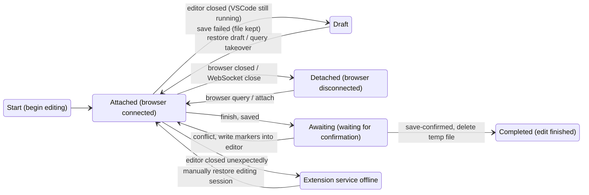

# MediaWiki VSCode External Editor

English | [简体中文](README.md)

An InPageEdit + VSCode Plugin combo that uses VSCode as the editor and the browser as the renderer.

## Installation

### VSIX

- [open-vsx.org](https://open-vsx.org/extension/minortex/mediawiki-vscode-editor)

- [vscode-marketplace](https://marketplace.visualstudio.com/items?itemName=minortex.mediawiki-vscode-editor)

Development builds are available under actions -> artifacts.

### IPE NEXT plugin

In InPageEdit, open Settings → Plugin Store and add the registry:

```
https://minortex.github.io/mediawiki-vscode-editor/ipe-plugin/registry.json
```

Development version:
```
https://minortex.github.io/mediawiki-vscode-editor/ipe-plugin/dev/registry.json
```

After installing:

- Allow access to local devices so the plugin can connect to the local service started by the extension.
- To jump to definitions from VSCode, you must allow the page to open in the browser the first time.

## Usage

The extension is in charge because it actually holds the user's unsaved changes. The web page only pushes site content and renders it, attaching to the extension so it can be closed at any time.

1. Add an "Edit whole page in VSCode" button to the IPE toolbox: it takes over whole-page editing only; the article body becomes a live preview, and the bottom bar provides the original IPE features.

2. Web side:
   - Click "Save changes" to submit.
   - Click "Cancel": if nothing changed, restore the page and close the editor automatically; if there are changes, ask whether to save them.
   - Multiple tabs of the same page can attach to one editing session: editor updates are pushed to every attached tab, and saving or cancelling in any tab ends the shared session.

3. Extension side:
- Editing commands:
  - Close editor / close editing session:
    - When the content differs from the original page, ask whether to save or discard.
    - When nothing changed, close the editor tab and delete the temp file directly.
    - Closing also tries to close the browser page spawned for the session.
    - After the editor exits unexpectedly and is reopened, editor tabs restored by VSCode keep working as sessions.
  - Restore editing draft:
    - If a draft was not restored for some reason, read it from the local file and restore the editing session manually.
  - Save the current file via IPE:
    - Same as "Save changes" on the web side.
    - If an edit conflict occurs on save, conflict regions with markers are written into the editor for manual merging.
  - Open the current page in the browser.

If you want to understand the four state transitions...

<details>
<summary>Expand</summary>



| State | Meaning |
|---|---|
| `Attached` | The browser WebSocket is connected and this window is editing |
| `Detached` | The session still exists, but the browser connection is gone |
| `Draft` | The VSCode editor is closed and the temp file is kept as a draft |
| `Awaiting` | Submitted successfully; waiting for the browser to reload and confirm the new content |


</details>

## Multiple wikis

- After connecting to the extension, the web plugin requests this wiki's `siteinfo` with the browser session and pushes it to the extension via the `register-wiki` message.
- The command palette lists wikis that have been connected before.

Temp files are grouped by site host: `<tempDir>/<host>/<page name>[.s<section number>].<timestamp>.wiki`.

## Language features

Powered by `wikiparser-node`: diagnostics and quick fixes, syntax/semantic highlighting, completion, hover, signature help, folding, outline, internal links, definitions/references/rename. Go-to-definition opens the target page in the browser; references and rename are limited to the current document.

Besides wikiparser's context completion, structural snippets are offered: headings, tables, quotes, tags, redirects, signatures, comments, etc. Accepting a parser-function completion (`#if`, `#switch`, `#invoke`, …) inserts a skeleton with parameter placeholders. `{{{`, `{{`, `[[`, `{|`, `<!--`, and `-{` close automatically; regions such as `<nowiki>`, `<pre>`, and comments get no snippets.

## Position sync

Heuristic search, because Parsoid would break the layout and DSR is not available on every wiki.

- Editor → preview: AST text item + section + occurrence, located within the same section of the preview.
- Preview → source: clicked text + section + occurrence, looked up in reverse; falls back to line-by-line text matching on failure.
- Textless templates: match expanded blocks by template name/parameters/section/index; on failure, highlight the whole section.

Most jumps work, but complex layouts can still make forward or reverse lookup fail.


## UI language

Runtime messages use English as the source language and switch automatically with VS Code's display language via `vscode.l10n`; Simplified Chinese is bundled (`l10n/bundle.l10n.zh-cn.json`). Manifest strings such as command titles and setting descriptions use `package.nls*.json`.

To add a language, copy `l10n/bundle.l10n.zh-cn.json` to the matching locale file (e.g. `bundle.l10n.ja.json`) and translate the values; keys must match the English source strings exactly. To change the VS Code display language, run "Configure Display Language" from the command palette.
