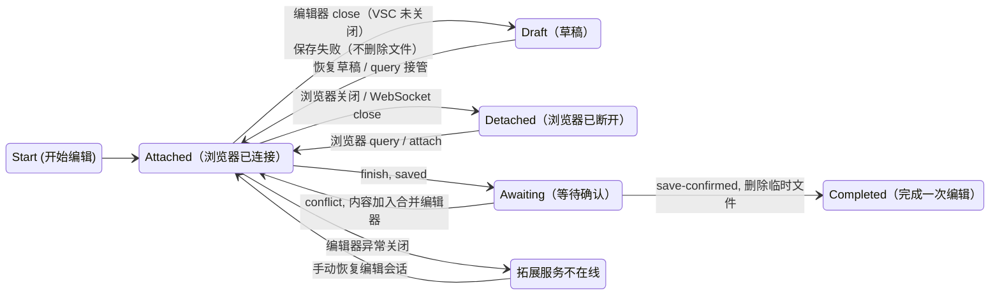

# MediaWiki ⇄ VSCode External Editor

一个用 VSCode 作为编辑器，把浏览器当做渲染器的 InPageEdit+VSCode Plugin 组合。

## 组成

- `ipe-plugin/src/index.ts`：InPageEdit NEXT 插件（TypeScript/Vite module），运行在任意 MediaWiki 站点页面里
- VSXI 扩展：本地 WebSocket 服务（默认 `127.0.0.1:8927`），把页面源码落到临时文件，保存时把内容推回浏览器。


## 安装

### VSXI

- [open-vsx.org](https://open-vsx.org/extension/minortex/mediawiki-vscode-editor)

- [vscode-marketplace](https://marketplace.visualstudio.com/items?itemName=minortex.mediawiki-vscode-editor)

开发版可在 actions -> artifacts 获取。

### IPE NEXT 插件

浏览器端在 InPageEdit 设置 → 插件商店添加注册表：

```
https://minortex.github.io/mediawiki-vscode-editor/ipe-plugin/registry.json
```

开发版：
```
https://minortex.github.io/mediawiki-vscode-editor/ipe-plugin/dev/registry.json
```

安装后需要：

- 允许访问本地设备，以连接到拓展建立的本地服务。
- 如果需要在 VSCode 里面跳转到定义，第一次需要在浏览器允许打开页面。

## 使用

- 替代了 IPE 的编辑按钮，浏览器正文即时变成预览，底部浮条可实现原来 IPE 的功能~~（IPE 还能叫 IPE 么）~~
- 点「保存更改」或用 VSC 命令面板提交；「取消」恢复原页面、关闭编辑器并丢弃本次会话。
- 编辑冲突时会提示并把同步 git 风格的到编辑器，这样你就可以用 VSC 的合并引擎来处理编辑冲突。

编辑预览状态下：

- 浏览器点正文里的 wiki 内链/VSC 下跳转到定义，会在新标签打开目标页并进入 IPE 编辑态，同时在 VSCode 打开目标页源码。当前标签的会话保留，可多标签并行。

拓展为主，网页只是 attach 到拓展上面。

你如果想了解四种状态转移的话...

<details>
<summary>展开</summary>



| 状态 | 含义 |
|---|---|
| `Attached` | 浏览器 WebSocket 已连接，当前窗口正在编辑 |
| `Detached` | 会话还在，但浏览器连接已断开 |
| `Draft` | VSCode 编辑器已关闭，临时文件保留为草稿 |
| `Awaiting` | 已提交成功，等待浏览器刷新并确认新内容 |


</details>

## 多 wiki

- 网页端脚本连接扩展后，会携带浏览器登录态请求本站`siteinfo`，通过`register-wiki`消息推送给扩展
- 命令面板可以查看已经连接过的 wiki。

临时文件按站点主机分目录：`<tempDir>/<host>/<页面名>[.s<节号>].<时间戳>.wiki`。

## 语言功能

由 `wikiparser-node` 驱动：诊断与快速修复、语法/语义高亮、补全、Hover、签名帮助、折叠、大纲、内链、定义/引用/重命名。定义跳转通过浏览器打开目标页；引用与重命名仅限当前文档。

## 位置同步

- 编辑器 → 预览：AST 文本项 + section + occurrence，在预览同 section 内定位。
- 预览 → 源码：点击处文本 + section + occurrence 反查；失败时逐行文本兜底。
- 无文本模板：按模板名/参数/section/序号匹配展开块；失败时高亮整个 section。

虽然已经尽可能保证大部分情况能跳转，但遇到复杂的排版还是有可能正查/反查失败。

